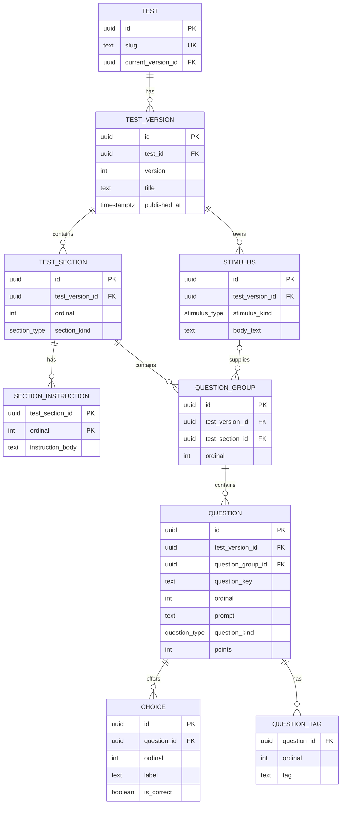
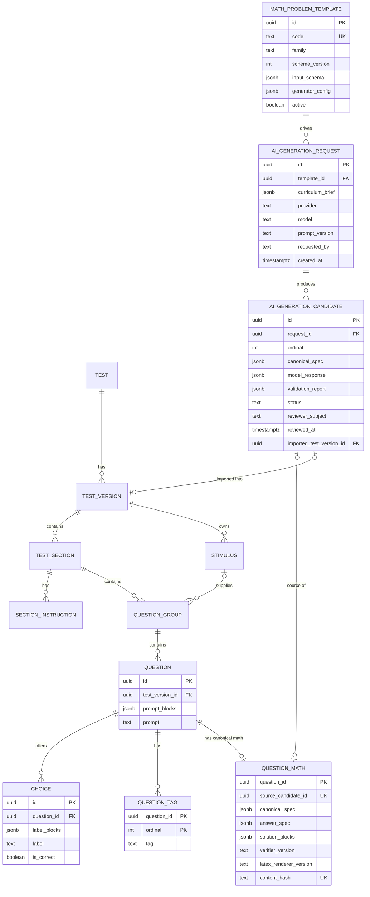

# AI Mathematics Rollout — Before and After ERD

## Before

Today, imported authored content belongs to a draft `test_version`, then is
frozen when published. A question and choice store only flat text. The
diagram includes the content graph that matters for question authoring; it
omits attempts, responses, and media-asset internals.

## After

The publication graph stays intact. AI workflow data is isolated in generation
tables until an admin approves a validated candidate. Published math metadata
is attached to a normal immutable question.

## Relationship rules

- `AI_GENERATION_CANDIDATE.status` is one of `pending`, `valid`, `rejected`,
  `approved`, or `imported`; only `approved` may be transformed into an import
  document.
- `QUESTION_MATH.question_id` is one-to-one and only exists for a question
  whose content uses math blocks. `source_candidate_id` is optional for
  manually authored math, otherwise unique and points to the approved source
  candidate.
- `QUESTION_MATH.content_hash` is unique across approved content to block
  exact canonical duplicates.
- `imported_test_version_id` is set only after the existing import succeeds.
- Published `QUESTION`, `CHOICE`, and `QUESTION_MATH` data is frozen by the
  same version-publishing rule that protects authored questions today. The
  new `QUESTION_MATH` table needs its own immutability trigger that resolves
  its parent question's `test_version_id`; existing triggers do not reach new
  child tables automatically.
- `prompt` and `label` remain the existing required compatibility fields while
  nullable `prompt_blocks` and `label_blocks` are introduced. Blocks become
  authoritative only after the importer, exporter, runner DTOs, and every
  active authoring path support them; removing the flat fields is a later
  breaking migration.
