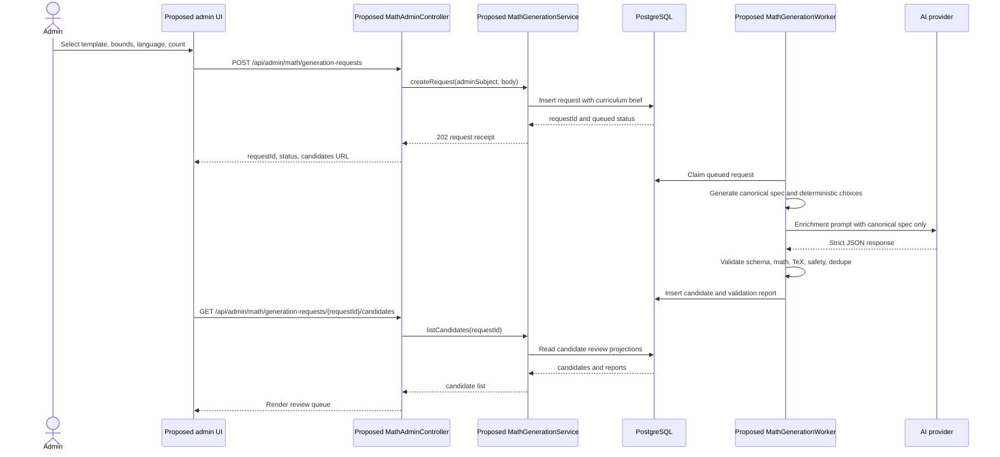
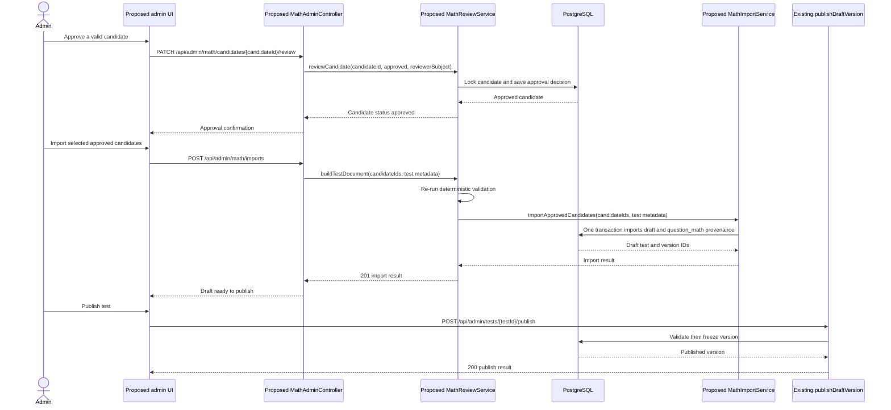
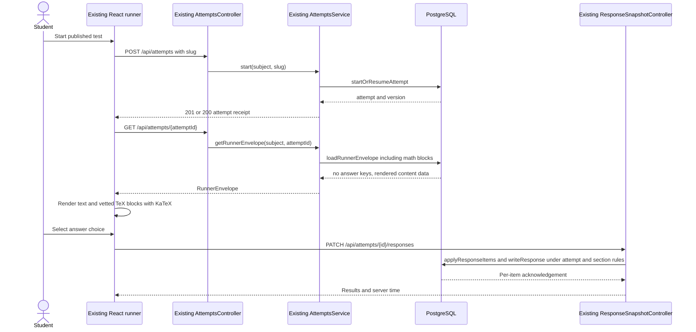
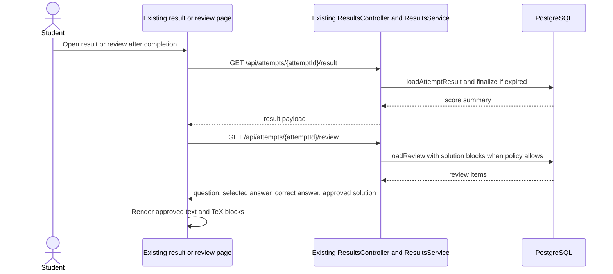

# AI Mathematics — Data and API Flows

## Status and reading guide

This is a rollout design, not implemented API behaviour. **Existing** names
are verified against the repository. **Proposed** names are the planned
interfaces needed to deliver the approved hybrid generation design. No
student attempt, response, result, or AI provider call exists today for math.

The invariant in every flow is: a canonical math specification determines
truth; LaTeX is an approved display representation; an AI response is never a
source of truth or a direct publication path.

## Data flow

```mermaid
flowchart LR
  Admin[Admin] -->|curriculum brief| AdminApi[Proposed math admin API]
  AdminApi --> Request[(ai_generation_request)]
  Request --> Worker[Proposed generation worker]
  Template[(math_problem_template)] --> Worker
  Worker --> Spec[Canonical MathProblemSpec and AST]
  Spec --> Validator[Deterministic validator]
  Worker -->|strict JSON only| Provider[AI provider]
  Provider --> Candidate[(ai_generation_candidate)]
  Validator --> Candidate
  Candidate -->|valid candidate| Review[Admin review UI]
  Review -->|approved| Importer[Existing import path]
  Importer --> Version[(test_version and content graph)]
  Importer --> Math[(question_math)]
  Version -->|existing publish path| Published[Published immutable version]
  Published --> Runner[Existing attempt runner]
  Math -->|prompt and choice blocks| Runner
  Math -->|approved solution blocks after completion| ReviewApi[Existing review path]
```



### Data ownership at each boundary

| Boundary | Input | Output | Authority |
| --- | --- | --- | --- |
| Template generation | Template configuration and recorded seed | `MathProblemSpec`, AST, answer spec, deterministic distractors | Application code |
| AI enrichment | Curriculum brief plus canonical spec | Wording, optional display TeX, explanation, rationale | Candidate only; untrusted until validated |
| Validation | Candidate plus canonical spec | Pass/fail report and normalized blocks | Deterministic validator |
| Review | Valid candidate and rendered preview | Approve, reject, regenerate decision | Administrator |
| Import | Approved candidate transformed to `TestDocument` | Draft `test_version`, questions, choices, `question_math` | Existing importer |
| Publish | Draft version | Immutable public version | Existing publication checks |
| Attempt/review | Published runner payload and stored responses | Score; optionally approved solutions after completion | Existing attempt/result logic |

`ai_generation_candidate.model_response` retains the raw AI response for
audit. The canonical spec and vetted content blocks copied into the imported
question are the only forms used by students or scoring.

## Proposed admin request-response flows

### 1. Create a generation request and receive reviewed candidates



**Proposed request**

```json
{
  "templateCode": "fraction-addition-v1",
  "count": 10,
  "curriculumBrief": {
    "level": "primary-step-1",
    "objectiveTags": ["fractions:add-like-denominators"],
    "language": "en",
    "difficulty": "introductory",
    "solutionPolicy": "after_test"
  }
}
```

**Proposed `202 Accepted` response**

```json
{
  "requestId": "uuid",
  "status": "queued",
  "candidatesUrl": "/api/admin/math/generation-requests/uuid/candidates"
}
```

The response is intentionally a receipt, not generated content. A provider
timeout, malformed response, or failed validator produces a failed candidate
record and report; it does not make the original POST ambiguous or retry a
provider request invisibly.

### 2. Review, import, and publish an approved candidate



The current application only exposes the final line of this flow:
`POST /api/admin/tests/import` followed by
`POST /api/admin/tests/{testId}/publish`.
The proposed math import endpoint must refactor the current importer into a
shared transactional primitive: it creates the draft content and
`question_math.source_candidate_id` together, or creates neither. It must not
call the current `AdminService.import()` and append provenance in a later
transaction, and it must never write published rows directly.

### 3. Student runs a published math section and saves an answer



The runner payload must contain display blocks but never `answer_spec`,
`is_correct`, canonical AST, raw AI data, or validator reports. Existing
multiple-choice response semantics remain unchanged: the browser sends selected
choice IDs, and server-side grading compares them with the stored choices.

### 4. Result and approved worked solution



The exact timing of solution visibility remains a product decision. Until it
is decided, `solution_blocks` is stored but omitted from runner and review DTOs
by default.

## Files and functions

### Existing integration points

| Concern | File | Function or class | Change needed for math |
| --- | --- | --- | --- |
| Interchange validation | `packages/common/src/interchange/test-document.ts` | `testDocumentSchema` | Add explicit `math` section type and optional content blocks while preserving legacy fields and round-trip compatibility. |
| Admin HTTP boundary | `packages/server/src/admin/admin.controller.ts` | `AdminController.import`, `publish`, `export` | Keep as final import/publish boundary; do not add provider calls here. |
| Admin orchestration | `packages/server/src/admin/admin.service.ts` | `AdminService.import`, `publish`, `export` | Reuse import/publish; math service supplies a validated `TestDocument`. |
| Draft import/export | `packages/db/src/repositories/test-import.repository.ts` | `importTestDocument`, `exportTestDocument` | Refactor to a shared transaction primitive so normal imports and math imports both persist/reconstruct content blocks; math imports add `question_math` provenance atomically. |
| Publication | `packages/db/src/repositories/publish.repository.ts` | `publishDraftVersion` | Add math-block and math-metadata validation without weakening current checks. |
| Database authority | `docs/db/schema.sql` | authored-content tables and immutability triggers | Add `math` enum value, block columns, math workflow tables, `question_math`, and an immutability trigger. |
| Attempt API | `packages/server/src/attempts/attempts.controller.ts` | `start`, `get`, `enter`, `submit` | No new student endpoint for v1; runner shape gains vetted blocks only. |
| Runner assembly | `packages/server/src/attempts/attempts.service.ts` | `getRunnerEnvelope` | Continue to enforce owned/running attempt checks before serving math content. |
| Runner read model | `packages/db/src/repositories/runner.repository.ts` | `loadRunnerEnvelope` | Project prompt/choice blocks; exclude answer spec and generation metadata. |
| Response write | `packages/server/src/responses/response-snapshot.controller.ts`, `packages/server/src/responses/apply-response.ts`, `packages/db/src/repositories/response.repository.ts` | `ResponseSnapshotController.flush`, `applyResponseItems`, `writeResponse` | Reuse the queued, choice-ID snapshot persistence unchanged. |
| Results/review | `packages/server/src/attempts/results.service.ts` | `getResult`, `getReview` | Gate solution blocks by the approved solution policy. |
| Student API client | `packages/app/src/lib/attempts-api.ts`, `packages/app/src/lib/flushHttp.ts` | `getRunnerEnvelope`, `getAttemptReview`, `apiFlushHttp.patch` | Consume extended DTOs without changing queued answer-write semantics. |
| Student rendering | `packages/app/src/components/ChoiceList.tsx` and runner pages | `ChoiceList` and route components | Render `ContentBlock[]` with a safe KaTeX component instead of plain strings only. |

### Proposed math feature files

| New file | Proposed exports | Responsibility |
| --- | --- | --- |
| `packages/common/src/math/content-block.ts` | `ContentBlock`, `contentBlocksSchema` | Shared text/TeX representation and strict schema. |
| `packages/common/src/math/problem-spec.ts` | `MathAst`, `MathProblemSpec`, `answerSpecSchema` | Allowlisted mathematical DSL and canonical types. |
| `packages/common/src/math/verify.ts` | `verifyMathProblem`, `deriveDistractors`, `renderCanonicalLatex` | Deterministic correctness, distractors, and canonical TeX. |
| `packages/server/src/math/math-admin.controller.ts` | `createRequest`, `listCandidates`, `reviewCandidate`, `importCandidates` | Proposed admin-only request/review/import HTTP endpoints. |
| `packages/server/src/math/math-generation.service.ts` | `createRequest`, `listCandidates`, `reviewCandidate`, `buildImportDocument` | Transactional workflow and boundary to existing import. |
| `packages/server/src/math/math-generation.worker.ts` | `runQueuedRequest` | Claims queued work, calls provider adapter, validates, persists candidates. |
| `packages/server/src/math/ai-provider.ts` | `MathEnrichmentProvider.enrich` | Provider-specific structured-output adapter; receives no learner data. |
| `packages/db/src/repositories/math-generation.repository.ts` | request/candidate CRUD and claim functions | Mutable workflow persistence and audit trail. |
| `packages/db/src/repositories/math-question.repository.ts` | `insertQuestionMath`, `loadMathBlocksForRunner` | Versioned canonical metadata and safe runner projection. |
| `packages/app/src/components/MathContent.tsx` | `MathContent` | KaTeX rendering with strict options and accessible fallback. |
| `packages/app/src/pages/admin/math-generation.tsx` | generation/review screen | Admin batch, candidate preview, validation report, approve/reject actions. |

## Error and security rules

| Situation | Response | Persisted state |
| --- | --- | --- |
| Invalid generation request | `400` problem response from proposed admin API | No request row |
| AI timeout or provider failure | Request remains complete with failed candidate outcome; queue can expose retry action | Request/candidate failure report, no imported question |
| Invalid JSON, bad TeX, wrong answer, duplicate | Candidate is rejected before review | Candidate plus validator report |
| Reviewer rejects item | `200` updated review state | Candidate stays rejected; no test data changed |
| Candidate changes after approval | Import re-runs validation and verifies approved status under lock | Import refused on mismatch |
| Student asks for unpublished content | Existing `409 test_not_published` behaviour | No content leaked |
| Runner request | Payload excludes answer keys, AST, raw provider response, and internal reports | None |

## Implementation order

1. Extend the published-content contract: math section type, `ContentBlock`,
   import/export, runner DTO, and safe rendering.
2. Add deterministic specs, verification, metadata storage, and admin review
   without an AI provider.
3. Add the asynchronous provider worker and feature-gated generation APIs.
4. Enable student-visible math only after contract, import/export, renderer,
   and end-to-end attempt/review flows pass together.
