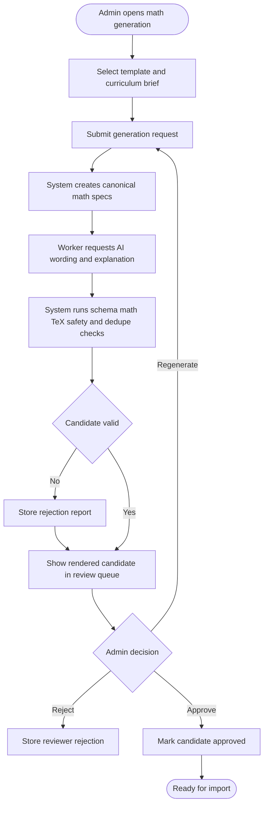
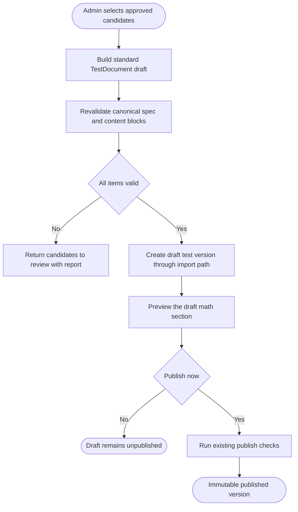
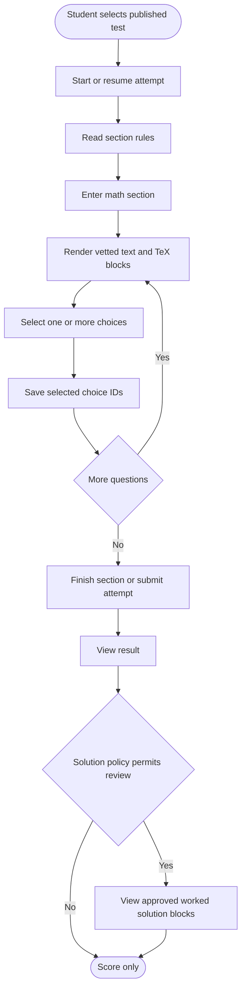

# AI Mathematics — User Journeys

## Scope

These journeys describe the proposed rollout. Generation and review are new
admin capabilities; test taking deliberately remains on the existing attempt
and answer-write path. A candidate is never visible to a student.

## Journey 1 — Admin creates a reviewed math batch

| Step | Actor | System effect |
| --- | --- | --- |
| Select brief | Admin | Chooses constrained family, ranges, level, language, count, and solution policy. |
| Submit | Admin | Saves a queued generation request; the API returns a request receipt. |
| Generate and enrich | Worker | Produces deterministic truth first, then requests structured wording only. |
| Validate | System | Verifies math, answer choice rules, TeX safety/rendering, and duplicates. |
| Review | Admin | Sees learner rendering, answer, solution, provenance, and explicit pass/fail results. |
| Approve | Admin | Makes a candidate eligible for import; it still is not published. |

## Journey 2 — Admin imports and publishes approved content

| Decision | Yes path | No path |
| --- | --- | --- |
| All items still valid? | Create a normal draft through the existing importer. | Keep affected candidates out of the draft and show their reports. |
| Publish now? | Existing publication checks freeze the version. | The draft remains private and editable through the normal workflow. |

No proposed workflow writes directly to `question`, `choice`, or a published
`test_version` outside the existing import/publish boundary.

## Journey 3 — Student completes a published math section

| Step | Student sees | Server guarantees |
| --- | --- | --- |
| Start/resume | Test title and attempt state | Only a published current version may start. |
| Runner load | Question and choice display blocks | No answer key, AST, raw AI response, or internal validation output. |
| Answer save | Selected choice state | Existing attempt ownership, timing, sequence, navigation, and change rules apply. |
| Result | Score after submission/expiry | Grading uses stored correct choices, not browser-supplied math. |
| Review | Approved explanation only when policy permits | Solution TeX comes from vetted `solution_blocks`, never raw AI text. |

## Journey boundaries

| Boundary | Allowed | Never allowed |
| --- | --- | --- |
| Admin generation | Curriculum constraints and canonical problem data reach the AI adapter. | Learner identity, attempt history, responses, or scores reach the provider. |
| Candidate review | Admin sees raw response and validator details. | A candidate becomes student-visible before approval, import, and publication. |
| Student runner | Student sees vetted display blocks and choices. | Student receives canonical AST, answer spec, `is_correct`, provenance, or raw model output. |
| Review | Student may see approved solution blocks according to policy. | Review reveals internal validator reports or permits mutation of a published question. |
