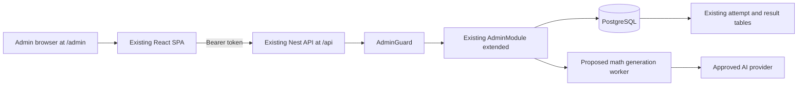
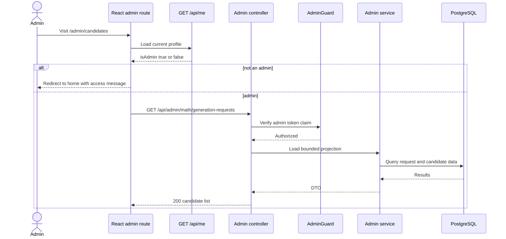

# Integrated Admin Module Design

## Intent

Provide a production admin workspace at `https://quiz.icovn.me/admin` where
authorized staff can review AI-generated mathematics candidates, manage quiz
drafts and published versions, inspect questions and answers, and understand
learner results. It is part of the existing single-page application and uses
the same `/api` origin and OIDC session as the learner experience.

This turns the proposed AI review queue into an actual deployable product
surface. It does not expose the database or require a separate admin host.

## Current foundation

- The app is a TanStack Router SPA served by the existing server, so a client
  route at `/admin` is deployable at `quiz.icovn.me/admin` with the same SPA
  fallback used for other browser routes.
- `GET /api/me` returns `isAdmin`, derived from the verified token claim.
- An admin follows the existing sign-in/session-provisioning path before
  loading `/admin`; this currently requires the same baseline access role as
  other authenticated users so a local `student` profile exists.
- Server routes can use `AdminGuard`; the existing test import/publish API
  already does so under `/api/admin/tests`.
- Authenticated user data is limited to the local `student` record. Access and
  admin roles are authoritative in the identity provider, not the quiz DB.
- There are currently no admin UI routes, candidate APIs, or math tables.

## Goals

- Give an admin a learner-faithful preview and explicit validation evidence
  before approving generated math content.
- Keep quiz content versioned and publication-safe while making drafts,
  questions, choices, and answers operable through the web application.
- Give staff privacy-conscious, read-only visibility of learner attempts and
  results.
- Reuse the current login, deployable SPA, API prefix, and server-side role
  enforcement.

## Non-goals

- No public or student-accessible admin content.
- No browser-originated direct database access or provider secret.
- No automatic candidate approval or publication.
- No role grant/revocation from the quiz UI; that remains at the identity
  provider.
- No editing of a published version; edits create or modify drafts only.

## Approaches considered

1. **Integrated `/admin` route in the existing SPA and API. Selected.** It
   shares session, deployment, domain, and the established `AdminGuard`, and
   meets the requested `quiz.icovn.me/admin` URL.
2. **Separate admin application.** It isolates deployments but duplicates OIDC
   session handling, routing, and operations, while still needing privileged
   API endpoints.
3. **Generic database console.** It bypasses workflow constraints, cannot
   safely render review evidence, and would make accidental mutation too easy.

## Chosen architecture



Both the SPA route guard and the API guard are mandatory. The client guard
prevents accidental navigation by non-admins; `AdminGuard` remains the actual
security boundary for every admin endpoint.

## Admin information architecture

```
/admin
├── Overview          Queue counts, draft/published quiz counts, result trends
├── Candidates        Generation batches and review queue
│   └── :candidateId  Learner preview, answer, validation report, provenance
├── Quizzes           Test catalogue, drafts, published versions
│   └── :testId       Sections, questions, choices, publish/export actions
├── Questions         Cross-quiz question search; read-only published records
├── Results           Aggregate and per-attempt result views
└── Learners          Searchable local profiles and their attempt history
```

The first release is a dense, editorial workspace: a clear left navigation,
large content preview, compact metadata rail, and explicit lifecycle/status
labels. The candidate detail page uses the learner rendering as the primary
panel, with validation evidence, canonical answer, and provenance in adjacent
panels. Raw AI JSON is an expandable audit drawer, never the default view.

## Pages and permitted actions

| Area | What an admin sees | Allowed actions | Explicit restriction |
| --- | --- | --- | --- |
| Overview | Counts, latest review work, drafts, recent result trends | Navigate to actionable work | No learner-level answers in summary widgets |
| Candidates | Batch, template, status, rendered question, choices, answer, solution, validator report, provenance | Approve, reject with reason, regenerate, import approved set | Cannot publish or silently alter a failed candidate |
| Quizzes | Test metadata, version status, sections, groups, questions, choices | Create draft from approved import, preview, export, publish valid draft | Cannot edit published version |
| Questions | Searchable question/answer content with quiz/version linkage | Inspect; edit only through its draft quiz workflow | No global mutation that crosses version boundaries |
| Results | Aggregates by test/version/section/question and attempt list | Filter, inspect one attempt, open approved review data | No answer mutation or user-specific AI adaptation |
| Learners | Local profile, level, result history | View; update quiz-local level/profile only if an endpoint is added | Cannot change authentication access or admin role |

## HTTP contract

### Existing endpoints consumed by the UI

| Endpoint | Use in `/admin` | Server owner |
| --- | --- | --- |
| `GET /api/me` | Client-side admin route gate | `SessionController.me` |
| `POST /api/admin/tests/import` | Create a quiz draft from a validated document | `AdminController.import` |
| `POST /api/admin/tests/:testId/publish` | Publish a valid draft | `AdminController.publish` |
| `GET /api/admin/tests/:testId/export` | Download/reconstruct a version | `AdminController.export` |

### Proposed admin endpoints

All proposed routes require both the existing bearer-token verification and
`AdminGuard`. Every response is a task-oriented projection; no endpoint emits
raw database rows by default.

| Endpoint | Purpose | Response shape |
| --- | --- | --- |
| `GET /api/admin/overview` | Counts and bounded recent activity | `AdminOverview` |
| `POST /api/admin/math/generation-requests` | Queue a bounded generation batch | `202 GenerationRequestReceipt` |
| `GET /api/admin/math/generation-requests` | Paginated generation-batch history | `MathGenerationRequestPage` |
| `GET /api/admin/math/generation-requests/:id/candidates` | List reviewable candidates | `MathCandidateSummary[]` |
| `GET /api/admin/math/candidates/:id` | Candidate detail and audit evidence | `MathCandidateDetail` |
| `PATCH /api/admin/math/candidates/:id/review` | Approve/reject with optimistic lifecycle guard | Updated candidate detail |
| `POST /api/admin/math/imports` | Turn selected approved candidates into a normal draft | `201 ImportResult` |
| `GET /api/admin/tests` | Paginated catalogue of draft and published tests | `AdminTestPage` |
| `GET /api/admin/tests/:id` | Version-aware quiz/editor projection | `AdminTestDetail` |
| `GET /api/admin/questions` | Filtered cross-quiz question search | `AdminQuestionPage` |
| `PATCH /api/admin/drafts/:versionId/questions/:questionId` | Draft-only question/choice edit, if approved | Updated draft question |
| `GET /api/admin/results` | Aggregated result and item-analysis page | `AdminResultPage` |
| `GET /api/admin/results/attempts/:id` | One learner attempt, answers, and score | `AdminAttemptDetail` |
| `GET /api/admin/learners` | Paginated local learner search | `AdminLearnerPage` |
| `PATCH /api/admin/learners/:id` | Optional local profile/level change | `AdminLearner` |

The list endpoints use explicit filters and pagination. Candidate detail is
the only endpoint that may return raw provider output, and it does so only in
an `audit` field available to an admin.

## Request and authority flow



The route gate is an asynchronous `beforeLoad` or route loader that calls the
existing `getCurrentStudent()` client function. It redirects unauthenticated
people through the existing sign-in path and sends authenticated non-admins
to the learner home route. It must never be treated as authorization by
itself: every privileged read and write goes through server `AdminGuard`.

## Data and privacy rules

- Candidate, quiz, and question detail may show answer keys only to admins.
- Result aggregation defaults to de-identified counts where practical; a
  learner name/email appears only in the learner and attempt-detail views.
- Admin attempt detail is read-only and is recorded in an immutable
  `admin_audit_log` with requesting admin subject, resource, action, and
  retrieval time. Candidate approvals, imports, publishing, and raw-provider
  audit access use the same log.
- Raw provider output has a configurable retention period and is visible only
  from candidate detail.
- Learner role/access changes remain out of scope because role truth resides
  in identity claims. The optional learner edit endpoint changes only local
  profile/level data.

## Implementation slices

1. **Access shell.** Add `/admin` route layout, `GET /api/me` route gate,
   server admin overview projection, navigation, and deny-state tests. The
   existing OIDC callback must establish the local session before redirecting
   an admin to this route.
2. **Quiz catalogue.** Add bounded test/version/read projections and admin
   pages; reuse existing import/export/publish actions. If approved, include
   inline edits for draft-only questions and choices.
3. **Results and learners.** Add paginated aggregate/attempt projections and
   read-only learner/result pages; decide whether local profile edits are
   enabled.
4. **Math review workflow.** Add generation tables, worker, candidate APIs,
   review detail, and import integration after the math content contract.
5. **Hardening.** Add audit logging, pagination limits, data retention job,
   access tests, responsive/accessibility review, and deployment smoke test.

The UI shell and read-only catalogue/results views can ship before AI math
generation. Candidate pages must not ship until their validator, persistence,
and admin APIs exist.

## Files expected to change

| Layer | Existing files to extend | New files or areas |
| --- | --- | --- |
| Web routes | `packages/app/src/pages/__root.tsx`, `packages/app/src/route.gen.ts`, `packages/app/src/lib/session-api.ts`, `packages/app/src/lib/api-types.ts` | `packages/app/src/pages/admin*.tsx`, `packages/app/src/lib/admin-api.ts`, admin components/tests |
| API | `packages/server/src/admin/admin.controller.ts`, `admin.service.ts`, `admin.module.ts`, `app.module.ts` | Admin read controllers/services/DTOs; later `packages/server/src/math/*` |
| Database | `docs/db/schema.sql`, `packages/db/migrations/*` | Admin read repositories; later generation/candidate repositories and audit logging |
| Contracts/tests | `docs/api/openapi.yaml`, existing admin/attempt E2E tests | Admin API contracts, access-control E2E tests, route/component tests |

Generated route code is updated through the repository's router generation
command; it is not hand-edited.

## Success criteria

- An authorized admin can sign in and visit `quiz.icovn.me/admin`; a learner
  cannot read or mutate admin data by URL or API call.
- Staff can locate a draft/published quiz and inspect its versioned questions
  and choices without exposing answers to a learner route.
- Staff can filter result aggregates and inspect a permitted individual
  attempt without modifying it.
- A math candidate is reviewed in a learner-faithful preview with validation
  evidence before it can reach import/publish.
- Published content and historical results stay immutable.

## Decisions retained for product approval

- Enable `PATCH /api/admin/learners/:id` for local level/profile editing, or
  make Learners completely read-only in the first release. The proposed
  default is **read-only first**.
- Exact raw-provider-response retention period and which admins can view it.
- Which result dimensions are suitable for the overview without revealing
  more learner data than needed.
- Confirm whether v1 includes **draft-only inline question/choice editing**
  (recommended) or manages questions/answers only through import/export. In
  either case, published versions remain immutable.
