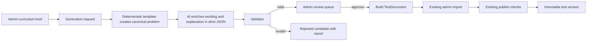

# AI-Assisted Mathematics Content Generation Design

## Intent

Let an administrator generate age-appropriate mathematics questions with AI
and LaTeX while keeping mathematical correctness, answer keys, publication,
and student safety under deterministic application control.

The product serves children. A plausible-looking wrong answer, unsafe markup,
or accidental publication is a product failure, not merely a model-quality
issue.

## Existing foundation

The current import schema already validates question/choice shape and answer
key cardinality. The existing admin workflow imports a draft test and publishes
that immutable version through `POST /api/admin/tests/import` and
`POST /api/admin/tests/{testId}/publish`. This design preserves that boundary:
generation candidates are never student-visible and can become test content
only by the existing import/publish path. That path first needs an explicit
`math` section type: today it admits only listening, reading, vocabulary, and
grammar sections.

## Goals

- Create varied mathematics items from a bounded curriculum specification.
- Render inline and display mathematics from stored LaTeX source.
- Make correct answers and distractors reproducible and independently
  verifiable.
- Give an administrator a reviewable audit trail from request through
  publication.
- Avoid sending learner records, attempts, or answers to an AI provider.

## Non-goals

- AI does not directly write published tests, answer records, or scoring data.
- Free-form LaTeX is not executed as code and is not parsed as the authority
  for arithmetic truth.
- The first release does not support open-ended/free-response marking.
- This does not replace the existing TOEFL Primary authoring/import workflow.
- This rollout does not silently repurpose a listening, reading, vocabulary,
  or grammar section as mathematics.

## Approaches considered

1. **Deterministic templates only.** Strongest correctness guarantees, but
   limited wording variety and expensive content authoring.
2. **AI drafts plus deterministic generation and verification. Selected.**
   The system owns values, answers, constraints, and final LaTeX; AI supplies
   wording, a worked explanation, and a candidate presentation. This gives
   variety without making model output authoritative.
3. **Fully AI-authored test JSON.** Fast to demonstrate, but requires manual
   rechecking of every fact and cannot safely automate publication.

## Target workflow



### 1. Curriculum brief

An admin starts a batch with an explicit, finite contract:

- level: `primary-step-1` or `primary-step-2`
- objective and skill tags, such as `fractions:add-like-denominators`
- problem family and allowed variable ranges
- required count, number of choices, language, and target difficulty
- prohibited contexts/terms and whether a worked solution is shown after an
  attempt

The brief is data, not an open-ended prompt. It is saved with the request so a
batch can be regenerated or audited later.

### 2. Canonical math comes first

For the first families, an in-process generator chooses a recorded seed and
produces a canonical `MathProblemSpec`. This is the source of truth; the
application derives the correct answer and rule-based distractors from it.

```ts
type MathProblemSpec = {
  family: "fraction_addition" | "percentage_of_quantity" | "linear_equation"
  seed: string
  variables: Record<string, number>
  expression: MathAst
  answer: { kind: "integer" | "rational"; numerator: number; denominator: number }
  constraints: { min: number; max: number; nonNegative: boolean }
}
```

`MathAst` is a small allowlisted AST (`integer`, `fraction`, `add`, `subtract`,
`multiply`, `divide`, `power`, `variable`, and `equation`), not a programming
language. The generator produces canonical LaTeX from that AST, rather than
trying to derive truth from untrusted model-written TeX.

The first release supports only deterministic families whose verifier is
complete: whole-number arithmetic, common fractions, percentages, ratios, and
one-variable linear equations. Geometry diagrams, word-problem units, and
algebraic equivalence follow after their individual verifiers exist.

### 3. AI enrichment

The AI receives the curriculum brief and canonical spec, but no student data.
It must return schema-constrained JSON containing:

- natural-language prompt blocks;
- optional LaTeX presentation blocks that must correspond to the canonical
  expression;
- an age-appropriate explanation;
- suggested distractor rationales.

The app ignores an AI-proposed `isCorrect` field. It maps its deterministic
answer/distractors into choices and stores the raw response only for audit and
debugging.

### 4. Validation gate

Every candidate must pass all gates before review:

| Gate | Deterministic check |
| --- | --- |
| Schema | Strict JSON schema; no unknown fields or prose outside the response object |
| Math | Evaluate the AST/answer; test equations with a bounded verifier |
| Choices | One correct single-choice answer; no duplicate/equivalent distractors |
| Difficulty | Values, operations, vocabulary, and answer magnitude are within the brief |
| LaTeX | KaTeX parses every `tex` block with `throwOnError: true` |
| Safety | `trust: false`; no raw HTML, URL, macro definition, or external-resource command |
| Deduplication | Canonical problem hash and normalized prompt similarity are not already approved |
| Import | Constructed `TestDocument` passes the existing Zod import schema |

A validator failure is retained as a report against the candidate; it is never
silently repaired or imported.

### 5. Human approval and publication

The review screen shows the learner rendering, answer/explanation, validator
report, and generation provenance side-by-side. An administrator may approve,
reject, or return a candidate for regeneration. Approval produces a standard
`TestDocument` draft; the existing import and publication checks remain the
sole route to a student-visible version.

## Content representation

Replace flat prompt/choice strings gradually with typed blocks:

```ts
type ContentBlock =
  | { kind: "text"; value: string }
  | { kind: "math"; tex: string; display: boolean }
```

The import API initially accepts legacy `prompt` and `label` strings as a
single text block. New math questions use `promptBlocks` and `labelBlocks`.
For an additive migration, retain the existing non-null text columns,
introduce nullable `prompt_blocks`/`label_blocks`, and backfill legacy rows
with one text block. Read APIs prefer blocks when present and otherwise derive
a text block from the legacy value. Once every active authoring and runner path
uses blocks, make the block columns non-null; removal of the legacy columns is
a later major schema revision.

The same extension is required in the interchange schema, importer, exporter,
admin preview, attempt/runner payloads, and their exact round-trip fixtures.
Adding JSONB columns alone is not a compatible feature: current import/export
tests deliberately require the exported document to exactly reproduce its
imported representation.

Store LaTeX source, never rendered HTML. The frontend renders blocks with
KaTeX using `trust: false`, `throwOnError: true`, bounded `maxSize`, bounded
`maxExpand`, and `output: "htmlAndMathml"`. A parse failure is a rejected
candidate in review and a visible authoring error, never a broken student
question.

## Data ownership and auditability

Generation tables are mutable workflow records; normal `question` and
`choice` rows retain the project's versioned/immutable publication model.
Every approved math question stores its canonical spec, answer spec, solution
blocks, verification version, and content hash alongside the imported row.

Record provider/model name, prompt-template version, request parameters, seed,
raw structured response, validator reports, reviewer subject, timestamps, and
the resulting `test_version_id`. Link an AI-created math question to its source
candidate using `question_math.source_candidate_id`; leave it null for a
manually authored math question. Restrict raw model output to admins and set a
retention policy; it may contain accidentally generated inappropriate wording
even though it contains no learner data.

New content tables must participate in the existing published-version
immutability boundary. In particular, the migration adds a trigger on
`question_math` which resolves its parent question and rejects insert, update,
or delete when that question belongs to a published version.

## Rollout

### Phase 0 — contract and rendering foundation

Add an explicit `math` section type to the database enum, interchange schema,
admin/import/export contracts, publish validation, runner payloads, and UI.
Add `ContentBlock`, KaTeX rendering, strict client/server TeX validation, and
preview fixtures. Preserve exact legacy import/export behavior. No AI and no
student-facing math content yet.

### Phase 1 — deterministic authoring

Implement `MathProblemSpec` for fraction and percentage templates, candidate
storage, validator reports, and an admin review UI. This validates the content
model and publication path with no model dependency.

### Phase 2 — AI-assisted wording

Add the generation worker and provider adapter behind a feature flag. Limit a
batch to 20 candidates, require review of every item, and collect rejection
reasons/evaluation metrics.

### Phase 3 — broaden families deliberately

Add one family at a time only after its deterministic verifier, fixture set,
and review rubric exist. Add linear equations before any geometry/diagram
family; diagrams need their own safe SVG/image pipeline and visual QA.

## Success measures

- 100% of published math questions have a passing deterministic verifier.
- 100% of published LaTeX blocks render in the supported KaTeX version.
- Zero direct AI-to-publish path.
- Track candidate acceptance rate, validation failure reason, reviewer edit
  rate, duplicate rate, and post-publication issue rate by template/model.

## Flow specifications

- [Data and API flows](../../architecture/2026-11-16-ai-math-data-and-api-flows.md)
  define the proposed asynchronous admin APIs, existing import/publish and
  attempt integration points, and the files/functions that own each boundary.
- [User journeys](../../processes/2026-11-16-ai-math-user-journeys-flow.md)
  show the admin generation/review path and the student experience after
  publication.

## Decisions left for approval

- Which AI provider and data-processing agreement are acceptable.
- Confirm an explicit `math` section type (recommended) rather than reusing a
  misleading existing section type.
- Whether the first math experience is a timed test section or an untimed
  practice mode; this changes section duration, navigation, and result flows.
- Whether worked solutions appear immediately after a response, only after
  test completion, or only to administrators in the first release.
- The first curriculum families and languages to support.
